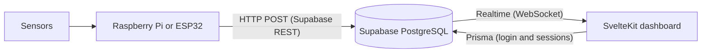

<div align="center">

# Tomatica

A real-time IoT monitoring dashboard for tomato cultivation.<br>
Sensor nodes write readings to Supabase, and the SvelteKit dashboard shows them live as cards, trend charts, and a history table.


</div>

## Table of Contents

- [Features](#features)
- [Architecture](#architecture)
- [Tech Stack](#tech-stack)
- [Getting Started](#getting-started)
- [Sending Sensor Data](#sending-sensor-data)
- [Available Scripts](#available-scripts)
- [Database Schema](#database-schema)
- [Authentication](#authentication)
- [Security Notes](#security-notes)
- [Project Structure](#project-structure)

## Features

- Three views: a dashboard with the latest reading, a statistics page with trend charts, and a table of recent readings.
- Live updates through a Supabase Realtime subscription. New rows appear without a page reload.
- Sensor cards grouped into air conditions, soil conditions, and weather and light.
- Line charts for the 30 most recent readings, with the minimum and maximum of each sensor.
- A history table of the 50 most recent readings, with a card layout on small screens.
- CSV export of the full `sensor_data` table.
- Device status indicator. The device counts as offline when the newest reading is more than 3 minutes old.
- Session-based login with bcrypt password hashing.
- An in-app technical documentation page at `/docs` for the Raspberry Pi and ESP32 sensor nodes.

The interface text is in Indonesian.

## Architecture



The sensor nodes are not part of this repository. They post readings to the Supabase REST API. The dashboard reads sensor data straight from Supabase in the browser and uses Prisma on the server for users and sessions.

## Tech Stack

| Layer | Technology |
| --- | --- |
| Framework | [SvelteKit](https://svelte.dev/docs/kit) with Svelte 5 (runes mode) |
| Styling | [Tailwind CSS v4](https://tailwindcss.com) |
| Database | [Supabase](https://supabase.com) (PostgreSQL) |
| ORM | [Prisma 6](https://www.prisma.io) |
| Authentication | Session cookies with [bcryptjs](https://github.com/dcodeIO/bcrypt.js) |
| Charts | [Chart.js](https://www.chartjs.org) |
| Icons | [Lucide Svelte](https://lucide.dev) |
| Dialogs | [SweetAlert2](https://sweetalert2.github.io) |
| Tooling | Vite 8, ESLint, Prettier |
| Package manager | [Bun](https://bun.sh) (npm also works) |

## Getting Started

### Prerequisites

- Node.js 20.19+ or 22.13+ (required by Vite 8 and ESLint 10)
- [Bun](https://bun.sh) 1.0+ (optional, npm works too)
- A [Supabase](https://supabase.com) project

### 1. Clone and install

```bash
git clone https://github.com/wildanzm/tomatica.git
cd tomatica
bun install
```

`postinstall` runs `prisma generate`, so the Prisma client is ready after install.

### 2. Configure environment variables

```bash
cp .env.example .env
```

| Variable | Description |
| --- | --- |
| `PUBLIC_SUPABASE_URL` | Project URL. Find it under **Settings > API**. |
| `PUBLIC_SUPABASE_ANON_KEY` | The `anon` public key from **Settings > API**. |
| `DATABASE_URL` | PostgreSQL connection string from **Settings > Database**. |

Use the direct connection string (port 5432) when you run `db:push`. For serverless hosting, use the transaction pooler (port 6543) at runtime and append `?pgbouncer=true&connection_limit=1`.

### 3. Create the tables

```bash
bun run db:push
```

### 4. Configure Supabase

Run the following in the Supabase **SQL Editor**.

Enable Realtime for the sensor table:

```sql
ALTER PUBLICATION supabase_realtime ADD TABLE public.sensor_data;
```

Lock down the tables the browser must not read. Prisma connects with the `postgres` role, which bypasses row level security, so the app keeps working:

```sql
ALTER TABLE public.users    ENABLE ROW LEVEL SECURITY;
ALTER TABLE public.sessions ENABLE ROW LEVEL SECURITY;
```

Allow the dashboard to read sensor data:

```sql
ALTER TABLE public.sensor_data ENABLE ROW LEVEL SECURITY;

CREATE POLICY "Dashboard can read sensor data"
  ON public.sensor_data FOR SELECT TO anon USING (true);
```

See [Security Notes](#security-notes) for why this matters.

### 5. Create the first user

There is no sign-up page. Generate a bcrypt hash:

```bash
node --input-type=module -e "import b from 'bcryptjs'; console.log(b.hashSync('YOUR_PASSWORD', 12))"
```

Then insert the user in the SQL Editor:

```sql
INSERT INTO public.users (id, username, password)
VALUES (gen_random_uuid()::text, 'admin', '<paste-the-hash-here>');
```

### 6. Run the app

```bash
bun run dev
```

Open [http://localhost:5173](http://localhost:5173) and sign in.

### Production build

```bash
bun run build
bun run preview
```

The project uses `@sveltejs/adapter-auto`. Switch to the adapter for your host if auto-detection does not support it, and set the three environment variables on that host.

## Sending Sensor Data

Each reading is one row in `sensor_data`. A node inserts a row through the Supabase REST API:

```bash
curl -X POST "$PUBLIC_SUPABASE_URL/rest/v1/sensor_data" \
  -H "apikey: $SUPABASE_SERVICE_ROLE_KEY" \
  -H "Authorization: Bearer $SUPABASE_SERVICE_ROLE_KEY" \
  -H "Content-Type: application/json" \
  -H "Prefer: return=minimal" \
  -d '{
    "air_temperature": 27.5,
    "air_humidity": 75.2,
    "lux": 15200.0,
    "soil_moisture": 68.0,
    "rainfall": 0.0,
    "wind_speed": 1.2,
    "soil_ph": 6.5,
    "nitrogen": 45,
    "phosphorus": 20,
    "potassium": 30,
    "co2": 410,
    "aqi": 42
  }'
```

`id` and `created_at` are filled in by the database, and every sensor field is optional. The service role key bypasses row level security, so keep it on the device and never expose it to the browser. The documented Raspberry Pi script sends a reading every 60 seconds, which keeps the device status indicator green.

## Available Scripts

| Script | Description |
| --- | --- |
| `bun run dev` | Start the development server |
| `bun run build` | Create a production build |
| `bun run preview` | Preview the production build |
| `bun run lint` | Run Prettier and ESLint checks |
| `bun run format` | Format the code with Prettier |
| `bun run db:push` | Push the Prisma schema to the database |
| `bun run db:migrate` | Run `prisma migrate dev` |
| `bun run db:seed` | Run `prisma/seed.js` (file not in the repository) |
| `bun run db:seed-sensor` | Run `prisma/seed-sensor.js` (file not in the repository) |

## Database Schema

### `users`

| Column | Type | Description |
| --- | --- | --- |
| `id` | text (UUID) | Primary key |
| `username` | text | Unique |
| `password` | text | bcrypt hash |
| `created_at` | timestamp | Defaults to now |

### `sessions`

| Column | Type | Description |
| --- | --- | --- |
| `id` | text (UUID) | Primary key |
| `token` | text | Unique session token |
| `user_id` | text | Foreign key to `users`, cascades on delete |
| `expires_at` | timestamp | Seven days after login |
| `created_at` | timestamp | Defaults to now |

### `sensor_data`

All sensor columns are nullable floats.

| Column | Type | Unit | Description |
| --- | --- | --- | --- |
| `id` | integer | | Primary key, auto-increment |
| `created_at` | timestamp | | Reading time, defaults to now |
| `air_temperature` | float | °C | Air temperature |
| `air_humidity` | float | % | Air humidity |
| `co2` | float | ppm | CO₂ concentration |
| `aqi` | float | AQI | Air quality index |
| `soil_moisture` | float | % | Soil moisture |
| `soil_ph` | float | pH | Soil pH |
| `nitrogen` | float | mg/kg | Nitrogen (N) |
| `phosphorus` | float | mg/kg | Phosphorus (P) |
| `potassium` | float | mg/kg | Potassium (K) |
| `lux` | float | lux | Light intensity |
| `rainfall` | float | mm/h | Rainfall |
| `wind_speed` | float | m/s | Wind speed |

## Authentication

- `src/hooks.server.js` guards every route except `/login`. That includes `/docs`.
- The login action compares the password with bcrypt and creates a session token with `crypto.randomUUID()`.
- The token is stored in a `session` cookie with `httpOnly`, `sameSite=lax`, and `secure` in production. The session expires after 7 days.
- Each login deletes the user's earlier sessions, so an account has one active session at a time.
- Visiting `/logout` deletes the session and redirects to `/login`.

## Security Notes

- **Enable row level security on `users` and `sessions`.** Tables created by Prisma in the `public` schema are reachable through the Supabase REST API with the public anon key. Without row level security, anyone holding that key can read password hashes and session tokens.
- **Keep the service role key on the devices.** It bypasses row level security. Never put it in `PUBLIC_*` variables or browser code.
- **The anon key is public by design.** Every table the dashboard queries from the browser needs an explicit row level security policy.
- **Do not commit `.env`.** It is already in `.gitignore`.

## Project Structure

```text
tomatica/
├── prisma/
│   └── schema.prisma          # users, sessions, sensor_data
├── src/
│   ├── app.html
│   ├── hooks.server.js        # Session validation and route protection
│   ├── lib/
│   │   ├── prismaClient.js    # Prisma singleton
│   │   └── supabaseClient.js  # Browser Supabase client
│   └── routes/
│       ├── +layout.server.js  # Passes the current user to the layout
│       ├── +layout.svelte
│       ├── +page.svelte       # Dashboard, statistics, and table views
│       ├── layout.css         # Tailwind entry point
│       ├── docs/              # In-app technical documentation
│       ├── login/             # Login form and action
│       └── logout/            # Session teardown
├── static/
│   └── robots.txt
├── .env.example
├── package.json
├── svelte.config.js
└── vite.config.js
```
